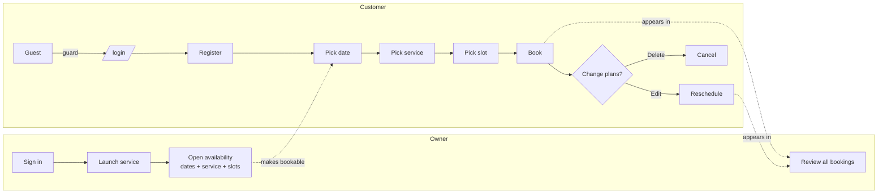
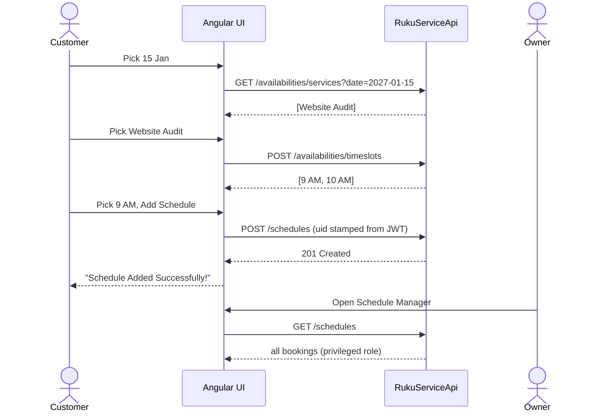
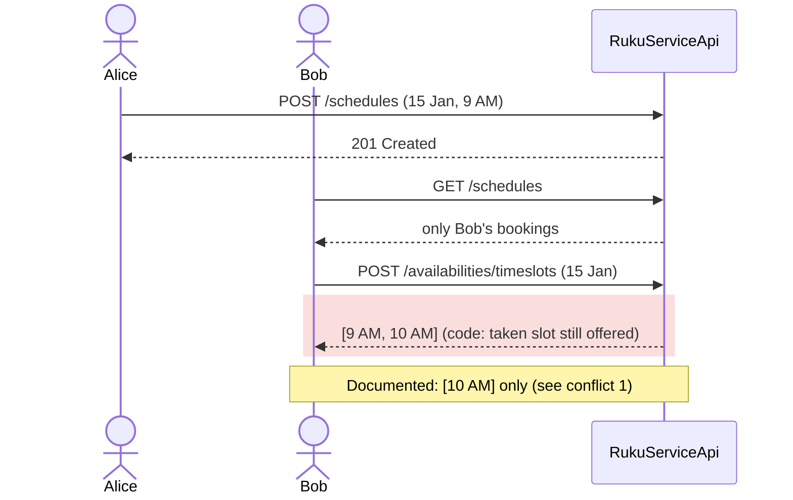
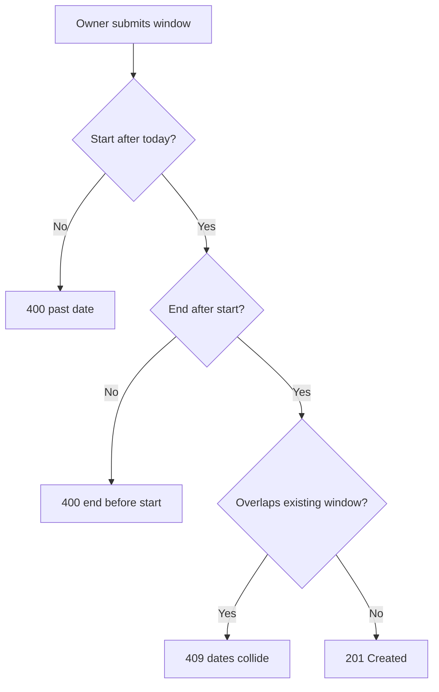

# Booking — Use-Case Flow

## Purpose

How an owner and their customers use Ruku Bookings end to end: who does what, what the
system must do at each step, and where the documents and the shipped code disagree.
This document is the review gate between the requirement documents and the generated
test cases.

## Evidence Basis

| | |
|---|---|
| Evidence mode | source + documents |
| Application source | `ruku-bookings` (Angular) + `RukuServiceApi` (.NET) |
| Documents ingested | 2 |
| Generated | 2026-11-23 |
| Use cases | 5 |
| Rules cited / inferred | 11 / 2 |
| Open conflicts | 2 |

> **Read the Documents vs. Implementation and Open Questions sections before using this
> document.** Anything tagged `(inferred — …)` has not been verified against an artifact.
> This document is the review gate: a wrong rule costs minutes here and days downstream.

## Actors

| Actor | Who | Role | How they get in |
|---|---|---|---|
| **Owner** | Runs the business; publishes services and opening hours | `Admin` / `Owner` | Signs in at `/login` |
| **Customer** | Books appointments | `Subscriber` | Registers at `/login` |
| **Guest** | Anyone not signed in | — | Sent to `/login` from any booking screen |

## The Big Picture

---

## UC1 — Customer books a service the owner published

**Goal:** a customer gets an appointment.
**Preconditions:** the owner has launched *Website Audit* and opened 10–20 Jan with 9 AM and 10 AM.

**Main flow**
1. Customer registers and opens Schedule Manager. Only dates inside an availability window can be picked.
2. Customer picks 15 Jan → only services available that day are offered.
3. Customer picks *Website Audit* → only that window's slots are offered.
4. Customer picks 9 AM, adds a note → *Add Schedule* → "Schedule Added Successfully!"
5. Owner opens Schedule Manager → sees the booking for 15 Jan, 9 AM.

**Rules**

| # | Rule | Source |
|---|---|---|
| 1 | Booking screens require a signed-in user; guests are sent to `/login`. | `auth.guard.ts` |
| 2 | Only dates inside an availability window can be picked. | `schedule-manager.component.ts` |
| 3 | Services and slots offered are those of the window covering the picked date. | `AvailabilitiesController.cs` |
| 4 | The server stamps each booking with the signed-in user's uid. | `SchedulesController.cs` |

---

## UC2 — Customer reschedules

**Goal:** move an appointment to another slot.
**Preconditions:** UC1 completed.

**Main flow**
1. Customer clicks *Edit* → the form loads the booking; the button reads *Update Schedule*.
2. Customer switches 9 AM → 10 AM → *Update Schedule* → "Schedule Updated Successfully!"
3. Owner sees one booking, now at 10 AM.

**Rules**

| # | Rule | Source |
|---|---|---|
| 5 | Editing updates in place and never creates a second booking. | Booking_Spec.pdf p.11 |
| 6 | A customer can edit only their own bookings. | `SchedulesController.cs` |

---

## UC3 — Customer cancels and the slot reopens

**Main flow**
1. Customer clicks *Delete* and confirms → "Schedule deleted successfully!"
2. The booking disappears for the customer and the owner.
3. The slot is offered again for that date.

**Rules**

| # | Rule | Source |
|---|---|---|
| 7 | A cancelled slot becomes bookable again. *(inferred — follows from rule 8)* | — |

---

## UC4 — Two customers want the same slot

**Main flow**
1. Alice books 9 AM on 15 Jan.
2. Bob opens Schedule Manager → he does not see Alice's booking.
3. Bob picks 15 Jan and *Website Audit* → 9 AM is not offered; 10 AM is.

**Alternate flow:** Bob submits 9 AM from a stale page → rejected as already taken.

**Rules**

| # | Rule | Source |
|---|---|---|
| 8 | A slot holds one booking. | Booking_Spec.pdf p.9 |
| 9 | A customer sees only their own bookings; owners see all. | `SchedulesController.cs` |

---

## UC5 — Owner opens an overlapping availability window

**Main flow**
1. Owner has a window 10–20 Jan and adds another for 18–25 Jan.
2. No second window is created.
3. Owner is told the dates collide.

**Rules**

| # | Rule | Source |
|---|---|---|
| 10 | Windows must start after today and end after they start. | `AvailabilitiesController.cs` |
| 11 | Windows may not overlap. | `AvailabilitiesController.cs` |
| 12 | Only owners manage services and availability. | Access_Matrix.xlsx p.2 |
| 13 | A day with no services shows nothing to book. *(inferred — documents are silent)* | — |

---

## Documents vs. Implementation

Every row where the requirement documents and the shipped code do not say the same thing.
Nothing here is resolved by this document — each row is a question for a named human.

| # | Rule / field | Documented | Implemented | Source | Status |
|---|---|---|---|---|---|
| 1 | Slot capacity | one booking per slot | taken slots stay offered; double booking accepted | Booking_Spec.pdf p.9 vs `AvailabilitiesController.cs` | ⚠ CONFLICT |
| 2 | Who manages services and availability | Owner / Admin only | any signed-in user | Access_Matrix.xlsx p.2 vs `AuthenticatedUser` policy | ⚠ CONFLICT |
| 3 | Placeholder services when a date has none | absent | three hard-coded services shown | `schedule-manager.component.ts` | UNDOCUMENTED |

Status vocabulary: `⚠ CONFLICT` (both sides state a value and they differ) ·
`NOT IMPLEMENTED` (documented, absent from source) ·
`UNDOCUMENTED` (in source, absent from the documents) · `AGREED` (both, matching).

## Proposed scenarios

| # | Scenario | Depth | Given | When | Then |
|---|---|---|---|---|---|
| 1 | UC1: Customer books a published slot | smoke | the owner has published Website Audit with 9 AM and 10 AM from 10 to 20 Jan | the customer picks 15 Jan and picks Website Audit and picks 9 AM and clicks Add Schedule | the message "Schedule Added Successfully!" is shown and the owner sees the booking for 15 Jan at 9 AM |
| 2 | UC1: Only published services and slots are offered | regression | the owner has published Website Audit with 9 AM and 10 AM from 10 to 20 Jan | the customer picks 15 Jan and picks Website Audit | only Website Audit is offered and only 9 AM and 10 AM are offered |
| 3 | UC2: Customer reschedules to another slot | regression | the customer has a 9 AM booking on 15 Jan | the customer clicks Edit and picks 10 AM and clicks Update Schedule | the message "Schedule Updated Successfully!" is shown and the owner sees one booking at 10 AM |
| 4 | UC3: Cancelled slot is offered again | regression | the customer has a 9 AM booking on 15 Jan | the customer clicks Delete and confirms and picks 15 Jan and picks Website Audit | the booking is gone for both actors and 9 AM is offered again |
| 5 | UC4: Taken slot is not offered to a second customer | regression | Alice has booked 9 AM on 15 Jan | Bob picks 15 Jan and picks Website Audit | only 10 AM is offered and Alice's booking is not visible to Bob |
| 6 | UC5: Overlapping window is refused with a reason | regression | the owner has a window from 10 to 20 Jan | the owner adds a window from 18 to 25 Jan | the message "Availability Dates collide with existing availability." is shown and no second window is created |

## Open Questions

| # | Question | Blocks |
|---|---|---|
| 1 | Is a slot exclusive to one customer? The spec says yes; the code allows double booking. | Scenario 5 |
| 2 | Should customers be able to manage services and availability? | Access coverage |
| 3 | What should a customer see on a date with no services? | Scenario 2 |
